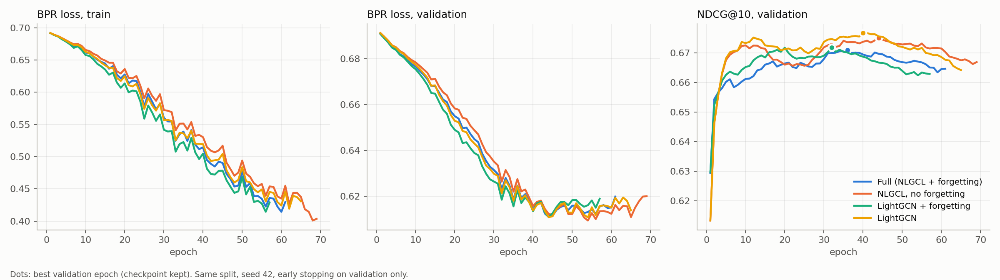

# Révise Malin

Révise Malin tells a student which skills to revise first, the ones they are most likely to get wrong, and lets them practise on real exam questions right away. Each answer updates the plan.

It is a graph recommender (LightGCN, with the NLGCL contrastive loss of RecSys 2025 and a learned forgetting curve as ablated options) trained on **DBE-KT22**: 733 students of a database course at the Australian National University, 212 multiple-choice questions with their text and 93 named skills.

Team: Grégoire Champourlier, Maxence Simonet, Hippolyte Nussbaumer, Dan Waintraub (ECE Paris, ING5 Data & AI).



## Run the demo (Python 3.11 to 3.14, about 5 minutes)

```bash
git clone https://github.com/ApparentlyGregz/RecommenderSystemProject.git
cd RecommenderSystemProject
python -m venv venv
venv\Scripts\activate                 # macOS/Linux: source venv/bin/activate
pip install -r requirements.txt
```

Download the data: on the [DBE-KT22 page of the Australian Data Archive](https://dataverse.ada.edu.au/dataset.xhtml?persistentId=doi:10.26193/6DZWOH), download `2_DBE_KT22_datafiles_100102_csv.zip` (2.7 MB) and put it, without unzipping, in `data/raw/dbe/`. The data is not in this repository because its licence for redistribution is not confirmed.

```bash
python run.py                         # then open http://localhost:8501
```

The first launch prepares the data (a few seconds). `run.py` starts the FastAPI backend (docs at http://localhost:8000/docs) and the Streamlit interface; `python run.py --lan` makes the demo reachable from another machine on the same network. No training and no PyTorch are needed: the trained model is in `artifacts/dbe/serving.npz`.

**In the app.** Pick a student and the time you have. The plan lists the riskiest skills, each with its evidence (your errors on it, how students with answers like yours did). "Practise now" shows a real question of the skill; check your answer to get the correction, and the plan moves: a wrong answer pushes the skill up, a correct one down. "I already know it" and "Not useful" remove a skill; "Replay from the dataset history" forgets the session. Everything you do is stored in SQLite (`data/feedback.db`).

## Results (test cut, 726 students)

Each student ranks the skills they practised in their last 30 answers. A skill is relevant if the student's error rate on it is above their own error rate in that window. Full tables: `reports/dbe/test_results.md` (paired bootstrap intervals) and `reports/dbe/seed_summary.md` (three training seeds).

| Method | NDCG@10 | Recall@5 |
|---|---|---|
| Random | 0.495 | 0.266 |
| Most-popular (most practised skills) | 0.550 | 0.283 |
| Personal error rate | 0.653 | 0.378 |
| Global error rate (skill difficulty) | **0.679** | 0.386 |
| LightGCN with skill bias (served) | 0.663 ± 0.002 | **0.394** ± 0.009 |
| NLGCL | 0.663 ± 0.001 | 0.393 ± 0.011 |
| LightGCN + forgetting | 0.651 ± 0.002 | 0.385 ± 0.002 |
| NLGCL + forgetting | 0.651 ± 0.002 | 0.383 ± 0.004 |

What this shows, honestly:
- Every model beats random and most-popular (95% intervals above zero). It beats the skill-difficulty baseline on Recall@5 but not on NDCG@10. On validation (middle of the course) the models were ahead of it; on test (end of the course) most skills are new to the student, and other students' error rate is hard to beat there.
- Neither the contrastive loss nor the forgetting term helps on this data: forgetting costs about 0.012 NDCG@10, more than five times the seed spread. We serve the simplest model with the best validation score.
- On EdNet (Weeks 2 and 3) we found and fixed a loss-scale bug in our NLGCL code and showed that the "failed at least once" label rewards exposure; the label above fixes that. See `reports/Revise_Malin_Week3_Status_Report.pdf`.

## Retrain and evaluate

```bash
pip install -r requirements-train.txt
python -m src.prepare_dbe                          # data/processed/dbe/ (events, skills, questions)
python -m src.train                                # full model; add --no-contrastive and/or --no-forgetting
python -m src.evaluate_test                        # every artifacts/dbe/model_*.pt vs baselines -> reports/dbe/
python scripts/seed_summary.py                     # three seeds per variant (train with --seed 1, 2 and --tag <variant>_s1 ...)
python -m src.export --model artifacts/dbe/model_nocl_noforget.pt    # -> artifacts/dbe/serving.npz
pytest                                             # 24 tests: split without leakage, metrics, model, API
```

Training a variant takes about a minute on a laptop CPU. Defaults (learning rate, batch size, skill bias) were chosen on the validation cut only. EdNet runs use the same code with `REVISE_MALIN_DATASET=ednet` (see the Week 3 report for the steps).

## How it works

- **Split without leakage** (`src/build_graph.py`). Each student's answers are sorted by time; three label windows of 30 answers (train, validation, test) sit at the end of the history. For each window, the graph, error rates and time gaps use only answers strictly before it. Tests check this (`tests/test_split.py`).
- **Model** (`src/model.py`). LightGCN on a student-skill graph (edge = past error), a learned bias per skill (its difficulty), the NLGCL neighbour-layer contrastive loss (averaged over the batch) and forgetting (edges weighted by 2^(-Δt/h), score term β(1 - 2^(-Δt/h)), one learned half-life per skill), trained with BPR on pairs of skills from the same window.
- **Serving** (`src/predict.py`, `api/main.py`). The trained embeddings are exported once; the API ranks skills with NumPy in under 10 ms, explains each one from the student's history and their 20 nearest students, and updates the ranking with the answers given in the app (the model's rank counts as two answers).
- **Interface** (`app/streamlit_app.py`). Calls the API for everything it shows. Questions are rendered from the dataset, with relational algebra as LaTeX. 56 of the 212 questions use tables from the course worksheet, which the dataset does not include; they are shown last, with a note.

```
src/        config, prepare_dbe (DBE-KT22), prepare_data (EdNet), build_graph, model, train,
            evaluate, evaluate_test, export, predict
api/        FastAPI app and SQLite storage
app/        Streamlit interface
scripts/    curves, seed summary, sample students, Week 2 and Week 3 evidence and report
reports/    Week 3 report, DBE-KT22 results (reports/dbe/)
tests/      pytest suite
```

## Data and references

- DBE-KT22: Abdelrahman et al., *DBE-KT22: A Knowledge Tracing Dataset Based on Online Student Evaluation*, 2022 ([arXiv 2208.12651](https://arxiv.org/abs/2208.12651), data on the [Australian Data Archive](https://dataverse.ada.edu.au/dataset.xhtml?persistentId=doi:10.26193/6DZWOH)).
- EdNet: Choi et al., 2020, © Riiid, [CC BY-NC 4.0](https://github.com/riiid/ednet), used for non-commercial coursework only.
- Xu et al., *NLGCL: Naturally Existing Neighbor Layers Graph Contrastive Learning for Recommendation*, RecSys 2025 ([code](https://github.com/Jinfeng-Xu/NLGCL)).
- He et al., *LightGCN*, SIGIR 2020. Settles and Meeder, *A Trainable Spaced Repetition Model for Language Learning*, ACL 2016.
